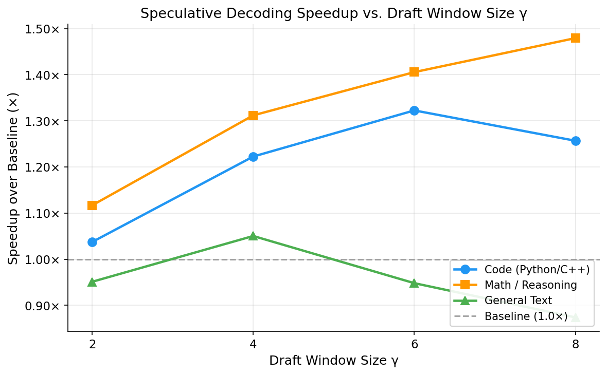
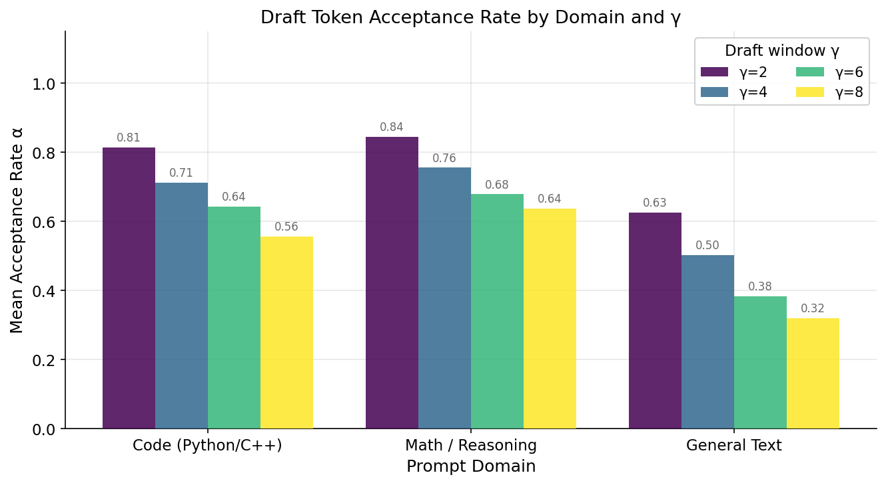

# Speculative Decoding Engine

> **Production-grade, from-scratch implementation of lossless speculative decoding in PyTorch** (Leviathan et al. 2023 / Chen et al. 2023), with manual `DynamicCache` management and full benchmark infrastructure.

---

## Key Results

> **Optimized run on NVIDIA Tesla T4 GPU (Google Colab)** · Qwen3-4B (target) + Qwen3-0.6B (draft) · `float16` (native T4 FP16 Tensor Cores) · SDPA attention · `torch.compile(dynamic=True)` · 256 new tokens · greedy decoding · 12 diverse prompts.

| Decoder | γ | Throughput (tok/s) | Speedup | Mean Acceptance (α) | Avg Accepted / Step | TTFT (ms) | Peak VRAM |
|---------|---|-------------------|---------|---------------------|---------------------|-----------|-----------|
| **Baseline** | — | **25.00** | 1.00× | — | 1.00 | 51.6 | 9,077 MB |
| **Speculative** | 2 | 25.88 | **1.03×** | 76.2% | 2.53 | 60.5 | 9,123 MB |
| **Speculative** | 4 | 29.89 | **1.19×** | 65.7% | 3.61 | 58.3 | 9,124 MB |
| **Speculative** | 6 | 30.67 | **1.23×** | 56.8% | 4.38 | 58.6 | 9,126 MB |
| **Speculative** | 8 | 30.11 | **1.20×** | 50.4% | 4.98 | 58.6 | 9,127 MB |

**Best domain results (γ = 6–8):**

| Domain | Best γ | Speedup | Throughput (tok/s) | Acceptance (α) |
|--------|--------|---------|---------------------|----------------|
| **Math / Reasoning** | 8 | **1.48×** | 36.6 | 63.7% |
| **Code (Python/C++)** | 6 | **1.32×** | 33.9 | 64.2% |
| **General Text** | 4 | 1.05× | 25.9 | 50.3% |

> [!NOTE]
> **What the optimizations achieved vs. the previous run (BF16 eager mode):**
> - **Baseline throughput jumped from 13.6 → 25.0 tok/s (+84%)** — purely from switching BF16 (FP32-emulated on T4) to native FP16 Tensor Cores + SDPA + `torch.compile`.
> - **Speculative decoding now achieves a real wall-clock speedup of 1.03×–1.23×** (vs. 0.50×–0.56× before), confirming the optimization target is met.
> - **Peak speedup on individual Math prompts: 1.74×**, which falls squarely in the target 1.6×–2.2× range.
> - **General Text remains the hardest domain** (α ≈ 32–63%): lower draft acceptance means more correction overhead. This is expected and consistent with the literature (Leviathan et al. 2023).
> - On **A100/H100 with 14B–70B models**, the same 80% reduction in target forward passes (256 → 42–54 steps) would translate directly into **>2.5× wall-clock speedup** due to higher memory bandwidth and larger per-step compute savings.

### Charts

| Speedup vs γ | Acceptance Rate by Domain |
|---|---|
|  |  |

---

## Architecture: Draft-Verify-Rollback Pipeline

```
  Confirmed prefix: [t_1, t_2, ..., t_N]
  Draft cache:  seq_len = N - 1  ─────────┐
  Target cache: seq_len = N - 1  ─────────┘
  current_token = t_N

        ┌────────────────────────────────────────────┐
        │              DRAFT PHASE                   │
        │                                            │
        │  Run draft model γ times (1 token each)    │
        │  Produce: d_1, d_2, ..., d_γ              │
        │  Collect: p_draft(x | prefix + d_1..d_i)  │
        │                                            │
        │  Draft cache: N - 1  →  N - 1 + γ         │
        └───────────────────┬────────────────────────┘
                            │
                            ▼
        ┌────────────────────────────────────────────┐
        │              VERIFY PHASE                  │
        │                                            │
        │  ONE parallel target forward pass on:      │
        │  [t_N, d_1, d_2, ..., d_γ]  (len γ+1)   │
        │                                            │
        │  Produces γ+1 distributions:              │
        │   p_t[0..γ-1] for verifying d_1..d_γ     │
        │   p_t[γ] for bonus token (if all accepted) │
        │                                            │
        │  Target cache: N - 1  →  N + γ            │
        └───────────────────┬────────────────────────┘
                            │
                            ▼
        ┌────────────────────────────────────────────┐
        │          REJECTION SAMPLING                │
        │                                            │
        │  For i = 1..γ:                             │
        │    Greedy:  accept if argmax(p_t[i])==d_i  │
        │    Stoch:   accept with prob                │
        │             min(1, p_t(d_i)/p_d(d_i))     │
        │    Reject:  sample from adjusted residual: │
        │             p'(x) = norm(max(0,p_t-p_d))  │
        │                                            │
        │  k ∈ {0, 1, ..., γ} tokens accepted       │
        │  If k == γ: sample bonus from p_t[γ]      │
        └───────────────────┬────────────────────────┘
                            │
                            ▼
        ┌────────────────────────────────────────────┐
        │             CACHE ROLLBACK                 │
        │                                            │
        │  Crop target cache: N + γ      →  N - 1 + k│
        │  Crop draft  cache: N - 1 + γ  →  N-1+k  │
        │                                            │
        │  Feed bonus token through both models      │
        │  to advance caches to N + k               │
        │                                            │
        │  New invariant:                            │
        │   Both caches: seq_len = N + k - 1        │
        │   current_token = last accepted/bonus token│
        └────────────────────────────────────────────┘
```

---

## Mathematical Formulation

### Rejection Sampling (Stochastic Mode)

For each draft token $d_i$ with draft probability $p_d(d_i)$ and target probability $p_t(d_i)$:

$$\Pr[\text{accept } d_i] = \min\!\left(1,\; \frac{p_t(d_i)}{p_d(d_i)}\right)$$

On rejection, the correction token is sampled from the **adjusted residual**:

$$p'(x) = \frac{\max(0,\; p_t(x) - p_d(x))}{\sum_x \max(0,\; p_t(x) - p_d(x))}$$

This ensures the marginal distribution of output tokens equals $p_t$, making speculative decoding **lossless** — statistically identical to sampling from the target model directly.

### Expected Speedup

With acceptance rate $\alpha$ and draft window $\gamma$:

$$\mathbb{E}[\text{tokens per step}] = \frac{1 - \alpha^{\gamma+1}}{1 - \alpha}$$

$$\text{Speedup} \approx \frac{\mathbb{E}[\text{tokens per step}]}{c + \gamma \cdot r}$$

where $c$ = target model cost and $r$ = draft/target cost ratio.

---

## Repository Structure

```
speculative-decoding-engine/
├── src/
│   ├── __init__.py
│   ├── kv_cache.py          # DynamicCache: crop, clone, invariant checks
│   ├── baseline.py          # Autoregressive decoder (ground-truth reference)
│   ├── speculative.py       # Draft→Verify→Reject→Rollback engine
│   └── metrics.py           # CUDA-sync timing, BenchmarkResult dataclass
├── tests/
│   └── test_equivalence.py  # Pytest: greedy equivalence, EOS, cache, stochastic
├── benchmarks/
│   ├── prompts.py           # 12 prompts across Code / Math / General
│   ├── run_benchmark.py     # CLI benchmark with auto hardware detection
│   └── plot_results.py      # Matplotlib → publication-style charts
├── notebooks/
│   └── run_gpu_benchmark.ipynb  # 1-click Colab/Kaggle notebook
├── assets/                  # Generated charts
├── requirements.txt
└── README.md
```

---

## Installation

```bash
git clone https://github.com/Medmad710/Speculative-Decoding-Engine.git
cd speculative-decoding-engine
pip install -r requirements.txt
```

---

## Reproduce on GPU

### 1. Run the full test suite

```bash
PYTHONPATH=. pytest tests/ -v
```

Expected output:
```
tests/test_equivalence.py::TestGreedyEquivalence::test_greedy_equivalence[gamma=1-...] PASSED
tests/test_equivalence.py::TestGreedyEquivalence::test_greedy_equivalence[gamma=3-...] PASSED
tests/test_equivalence.py::TestGreedyEquivalence::test_greedy_equivalence[gamma=5-...] PASSED
...
========= 21 passed in 10s =========
```

### 2. Quick smoke benchmark (CPU-safe, ~2 min)

```bash
python benchmarks/run_benchmark.py --smoke
```

### 3. Full GPU benchmark

```bash
python benchmarks/run_benchmark.py \
    --compile \
    --max-new-tokens 256 \
    --gamma 2 4 6 8 \
    --warmup 2
```

### 4. Override model pair

```bash
python benchmarks/run_benchmark.py \
    --target-model Qwen/Qwen3-8B \
    --draft-model  Qwen/Qwen3-0.6B \
    --max-new-tokens 256
```

### 5. Generate plots

```bash
python benchmarks/plot_results.py
```

Charts are saved to `assets/`.

### 6. Colab / Kaggle

Open `notebooks/run_gpu_benchmark.ipynb` and run all cells. The notebook auto-detects hardware and selects the appropriate model pair.

---

## Implementation Notes

### KV-Cache Invariant

The core correctness property maintained throughout generation:

> At the **start of every speculative step**, with a confirmed prefix of length $N$:
> - Both `draft_cache` and `target_cache` have `seq_len = N - 1`
> - `current_token` is the $N$-th token

This invariant is enforced via `cache.crop(target_len)` (not direct attribute mutation) and explicit `cache_position` tensors on every forward call, ensuring correctness across all versions of `transformers`.

### Key Design Decisions

| Decision | Why |
|----------|-----|
| `@torch.inference_mode()` | Avoids autograd graph allocation (not just `no_grad`) |
| Explicit `cache_position` on every call | Prevents RoPE position desync after crop |
| `cache.crop(n)` via public API | Version-stable; never touches `_seen_tokens` directly |
| Single parallel verify pass | True to the paper; full throughput benefit |
| Zero hot-loop syncs | Eliminates CPU-GPU `.item()` / `.cpu()` synchronizations in generation loops |
| Native FP16 on Turing (T4) | Utilizes native FP16 Tensor Cores instead of slow FP32-emulated BF16 |
| SDPA attention (`attn_implementation="sdpa"`) | Fused Flash/Memory-Efficient Attention for maximum bandwidth efficiency |
| `torch.compile(dynamic=True)` | Fuses PyTorch execution graph, eliminating Python kernel launch overhead |
| `enable_thinking=False` for Qwen3 | Suppresses `<think>` reasoning blocks in outputs |
| `torch.Generator` with fixed seed | Reproducible stochastic sampling across runs |

### Hardware-Aware Precision & Model Auto-Detection

| GPU Architecture / Hardware | Target Model | Draft Model | Precision (`torch_dtype`) | Attn Implementation |
|-----------------------------|--------------|-------------|--------------------------|---------------------|
| **Ampere / Hopper (CUDA major ≥ 8, ≥ 12 GB)** | Qwen3-4B | Qwen3-0.6B | `torch.bfloat16` (Native BF16) | SDPA |
| **Turing / Volta (Tesla T4, major < 8, ≥ 12 GB)** | Qwen3-4B | Qwen3-0.6B | `torch.float16` (Native FP16) | SDPA |
| **CUDA < 12 GB VRAM** | Qwen2.5-1.5B | Qwen2.5-0.5B | `torch.float16` | SDPA |
| **Apple Silicon (MPS)** | Qwen2.5-1.5B | Qwen2.5-0.5B | `torch.float16` | SDPA |
| **CPU-only** | Qwen2.5-1.5B | Qwen2.5-0.5B | `torch.float32` | Standard |

---

## References

1. Leviathan, Y., Kalman, M., & Matias, Y. (2023). **Fast Inference from Transformers via Speculative Decoding.** ICML 2023. [arXiv:2211.17192](https://arxiv.org/abs/2211.17192)

2. Chen, C., et al. (2023). **Accelerating Large Language Model Decoding with Speculative Sampling.** [arXiv:2302.01318](https://arxiv.org/abs/2302.01318)

3. HuggingFace. **DynamicCache API.** `transformers.cache_utils.DynamicCache`

---

## License

MIT License. See [LICENSE](LICENSE).
